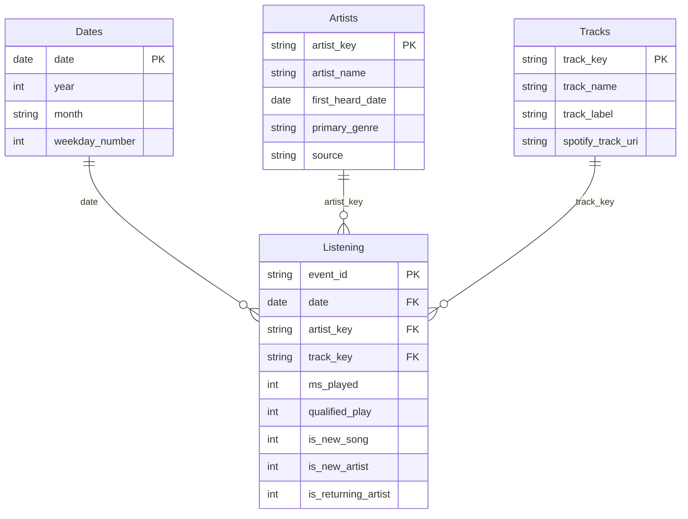

# Power BI model and report

## Open and refresh

Open `powerbi/SpotifyTracker.pbip`, then select Refresh. The report references
`SpotifyTracker.SemanticModel` by relative path. Its `DataFolder` Power Query
parameter points to the generated CSV folder. The pipeline sets that absolute
path for the current checkout; edit it in Desktop after relocating the project.

Use standard Power BI Desktop with PBIP/PBIR support. If the project format is
unavailable, check its project/PBIR preview settings and Microsoft's documentation
linked in the README. Report Server Desktop does not support these projects.

The files use PBIR report format 2.0.0 and a TMSL `model.bim` semantic model with
compatibility level 1600 and Power BI V3 data-source metadata. CSVs use UTF-8,
explicit types, and en-US numeric parsing. Empty values become null before
conversion, so unknown skip flags remain unknown.

## Star schema

Relationships are many-to-one, single direction from dimensions to the fact.
There is no Artists-to-Tracks relationship: both already filter the fact and
another path could introduce ambiguity. Track labels include artist names and
a short stable key to distinguish recordings sharing a title. Dates are
continuous; weekdays sort by Monday=0 through Sunday=6.

## Interaction and scope

Each page has year, artist, and audio/video slicers. Chart selections use default
Power BI cross-filter/highlight behavior. Slicers are page-local. Discovery and
loyalty use fixed first-observed history computed in Python; filtering to a later
year does not turn older songs/artists into new discoveries. Top artist/song
measures rank dynamically within the selected population.

Average minutes/day divides by selected calendar dates, including zero-music
dates. Genre coverage follows current filters. Selecting a mapped genre gives
full coverage for that genre; clear genre selections to assess wider coverage.

## Validation

`scripts/validate_powerbi.py` checks PBIP/PBIR against public Microsoft schemas.
Unit tests check model field references, measures, and visual bounds. These do
not execute DAX/Power Query or validate Power BI's native renderer. Open and
refresh in Desktop to complete native validation. The PNG preview is a separate
Python chart, not a native Power BI screenshot.

## Maintenance

Run Python again after adding exports or editing the genre CSV, then refresh
Desktop. Python regenerates report definitions as well as data. Keep Desktop
closed during rebuilds and commit custom report edits first. To preserve hand
edits, save a separate report copy or update the generator before rebuilding.

The model imports local files. Refresh after cloud publishing requires a gateway
or a cloud-accessible data source; cloud publishing and scheduled refresh are not
configured. PBIX files and Power BI caches contain data and are excluded from Git.
